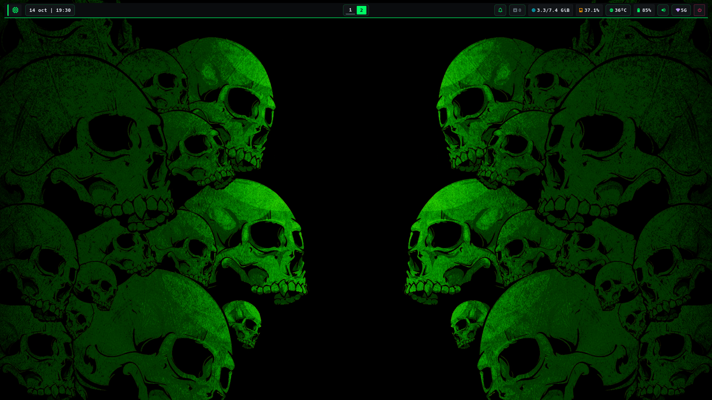
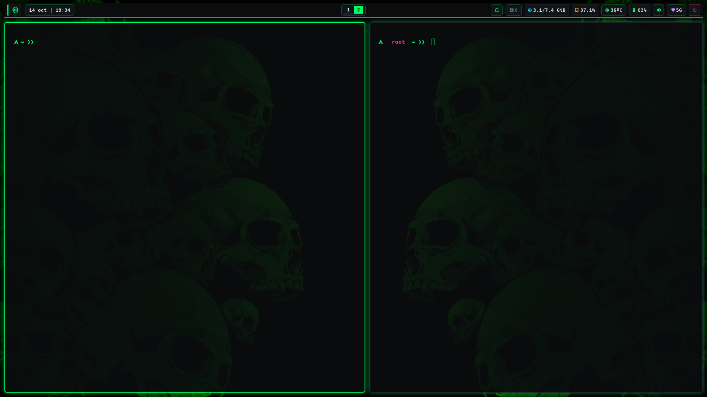
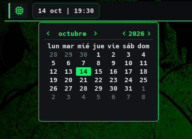
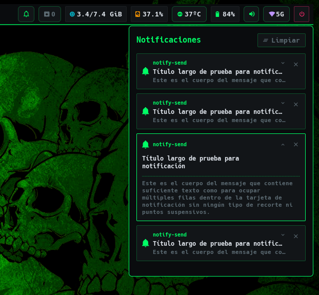
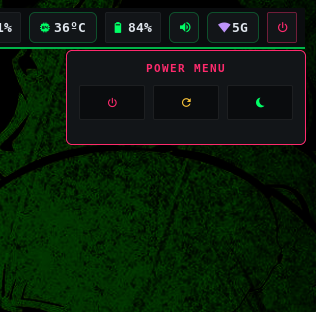
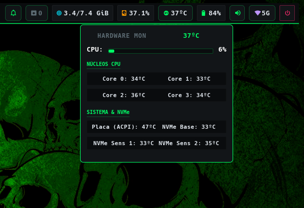

<div align="center">

# ☣ TNPUNK
### TOXIC NEON PUNK · ARCH LINUX DOTFILES

**A custom X11 desktop from the neon-soaked edge of the future.**  
**Un escritorio X11 personalizado desde el filo neón del futuro.**

<br>


[](./LICENSE)

<br>



<br>

`BSPWM` · `SXHKD` · `EWW` · `Rofi` · `Kitty` · `Picom` · `Zsh`

[English](#english) · [Español](#español) · [Repository](https://github.com/gr0cx/dotfiles)

</div>

---

<a id="english"></a>

## `01` / English

TNPUNK is a personal dotfiles project for building a **dark, keyboard-driven Arch Linux desktop on X11**. It brings window management, a custom status bar, popups, notifications, terminal, launcher, shell, login screen, and GTK styling into one toxic-neon visual system.

This repository is both the configuration and an **interactive system installer**. It is designed for people who are comfortable reviewing shell scripts and making system-level changes; it is not a portable, read-only theme switcher.

### ◈ System blueprint

| Layer | Components | Role in the setup |
| --- | --- | --- |
| Window manager and input | BSPWM · SXHKD | Tiling desktops, window rules, and keyboard shortcuts |
| Desktop widgets | EWW · GTK/SCSS · Python | Status bar, resource readouts, popups, notification UI, and battery alerts |
| Launcher and terminal | Rofi · Kitty | Application search, command entry, and a themed terminal |
| Rendering and wallpaper | Picom · `feh` | Compositor effects and wallpaper placement |
| Shell and prompt | Zsh · Starship · fzf | Interactive shell, prompt, completion, aliases, and search |
| Login and system look | LightDM · GTK theme | Display manager configuration and TNPUNK GTK theme |

The palette is built around `#0A0C0E` (near-black), `#121518` (surface), and `#00FF66` (toxic green), with muted slate and alert pink as supporting colors.

### `02` / What is in the desktop

- **BSPWM** starts ten named workspaces (`I`–`X`), applies window rules, and sets spacing, borders, focus behavior, and monocle layout options.
- **SXHKD** maps keyboard and media keys to BSPWM, Kitty, Rofi, audio controls, brightness controls, power actions, and optional applications.
- **EWW** provides the top bar and popup windows. The bar can show workspaces, time, notifications, package-update count, memory, disk, CPU temperature, battery, volume, and network state. Separate widgets provide calendar, CPU, volume, notification-center, and power-menu interfaces.
- **EWW helper scripts** read workspace, volume, network, and update state. A Python notification daemon connects desktop notifications to the themed toast and history views; a shell loop sends low/full battery notifications.
- **Rofi, Kitty, Picom, and Zsh** share the same color and typography choices. The shell configuration adds Zsh plugins, fzf styling, aliases, and a Starship prompt.
- **LightDM and GTK** extend the look to the login screen and GTK 3 theme. The session startup files launch the desktop helpers and wallpaper.

### `03` / Repository map

```text
.
├── assets/                         # Wallpaper assets
├── config/
│   ├── bspwm/                      # BSPWM startup and window rules
│   ├── eww/                        # Widgets, SCSS styles, Python/shell helpers
│   ├── kitty/                      # Terminal settings and colors
│   ├── picom/                      # Compositor settings and animations
│   ├── rofi/                       # Application-launcher theme
│   ├── sxhkd/                      # Shortcuts and shortcut helper scripts
│   └── starship.toml               # Prompt configuration
├── home/
│   ├── .local/bin/                 # User-level helper scripts
│   ├── .xprofile                   # X session startup helper
│   └── .zshrc                      # Zsh configuration
├── system/
│   ├── lightdm/                    # Display-manager configuration
│   └── themes/TNPUNK/              # GTK theme files
├── screenshots/                    # Desktop and widget previews
├── install.sh                      # Interactive Arch Linux installer
├── LICENSE                         # MIT License
└── README.md
```

### ⚡ `04` / Install

#### Requirements

- An **Arch Linux** system using `pacman` and `systemd`.
- An **Xorg/X11** session; this setup is not configured as a Wayland desktop.
- A regular user account with `bash`, `git`, an internet connection, and permission to run `sudo`.
- A terminal session: the installer asks interactive questions and must **not** be run as root.
- A backup of any system configuration you cannot afford to replace.

#### Install the dotfiles

```sh
git clone --depth 1 https://github.com/gr0cx/dotfiles.git
cd dotfiles
chmod +x install.sh
./install.sh
```

The `--depth 1` option downloads the latest snapshot without the full Git history. Omit it if you want the complete history. The installer asks for confirmation before making changes, requests sudo credentials, and asks whether to configure root and reboot at the end.

> **Review before running:** read [`install.sh`](./install.sh). This script installs packages and writes to system paths. It does not provide an uninstall command or a complete rollback.

#### What `install.sh` does

The script uses `set -eo pipefail`, rejects execution as root, keeps its sudo authorization alive during the run, and prints an error message if a command fails. It proceeds through these operations:

| Phase | Actions |
| --- | --- |
| 1 · Locale | Enables the locale selected at startup (`en_US.UTF-8` or `es_ES.UTF-8`), runs `locale-gen`, and writes the selected `LANG` to `/etc/locale.conf`. |
| 2 · Base packages | Runs `sudo pacman -Syu --needed --noconfirm` to synchronize and upgrade packages, then installs the package set listed below. |
| 3 · Paru | If `paru` is not already working, clones its AUR packaging repository to `/tmp/paru`, builds it with `makepkg`, installs the package with `pacman`, and removes that temporary directory. |
| 4 · EWW | Uses `paru` to install `eww` from the AUR. |
| 5 · Zsh plugins | Clones `zsh-syntax-highlighting` and `zsh-autosuggestions` into `~/.zsh`; downloads the Oh My Zsh `sudo` plugin into the same directory. Existing plugin directories are left in place. |
| 6 · Dotfile links | Links entries from `home/` into `$HOME`, `config/` into `~/.config`, user scripts into `~/.local/bin`, and `assets/` to `~/Pictures/Wallpapers`. Conflicting user-level destinations are moved into a timestamped `~/.config_backup/` directory first. |
| 7 · Optional root setup | If confirmed, copies the Zsh plugins for root, links the repository's `.zshrc` and Starship config into root's home, and attempts to set root's login shell to Zsh. |
| 8 · Final setup | Sets executable bits on selected scripts, attempts to set the user's login shell to Zsh, applies the first JPG/PNG/JPEG wallpaper it finds, copies LightDM and GTK theme files, enables `accounts-daemon.service` and `lightdm.service`, and writes the selected Xorg keyboard layout (`us` or `es`). |
| Finish | Prints the backup location when one was created and offers to reboot immediately. Declining the reboot leaves it to you to start the configured session later. |

The installer’s numbered progress messages correspond to its eight main progress phases; locale setup is also announced before the package phase.

#### Packages and plugins

The base package list passed to `pacman` is:

<details>
<summary>Show package inventory</summary>

| Group | Packages |
| --- | --- |
| Build and shell | `base-devel`, `git`, `rust`, `zsh`, `lsd`, `bat`, `fzf`, `starship` |
| Desktop and Xorg | `firefox`, `feh`, `bspwm`, `sxhkd`, `kitty`, `picom`, `rofi`, `xorg-setxkbmap`, `mesa` |
| EWW runtime support | `python`, `python-dbus`, `python-gobject`, `dconf`, `xdg-desktop-portal`, `xdg-desktop-portal-gtk` |
| Login and font | `ttf-hack-nerd`, `lightdm`, `lightdm-gtk-greeter`, `accountsservice` |
| Media and controls | `maim`, `imagemagick`, `xsecurelock`, `pamixer`, `alsa-utils`, `playerctl`, `brightnessctl`, `mpv` |
| Utilities | `jq`, `socat`, `xclip` |

In addition, the script installs **EWW** through the AUR and installs **Paru** from the AUR if it is missing. Zsh plugins are fetched directly from their upstream Git repositories.

</details>

### ⚠ `05` / System changes and safety

The installer makes system-wide changes in addition to linking files in your home directory:

| Location or service | Change |
| --- | --- |
| `/etc/locale.gen`, `/etc/locale.conf` | Enables and selects the locale chosen at startup: English (US) or Spanish (Spain), both UTF-8. |
| `/etc/lightdm/lightdm.conf`, `/etc/lightdm/lightdm-gtk-greeter.conf` | Replaces these files with the repository versions when the copy succeeds. |
| `/usr/share/themes/TNPUNK/` | Copies the GTK theme into the system theme directory. |
| `/etc/X11/xorg.conf.d/00-keyboard.conf` | Writes an Xorg keyboard configuration using the selected layout (`us` or `es`); an existing file at this path is overwritten. |
| systemd | Enables `accounts-daemon.service` and `lightdm.service` for startup. |
| Login shell | Attempts to change the current user's default shell to Zsh; root's shell change is optional. |

**Backups are limited.** The timestamped backup applies to conflicting user-level symlink destinations. The script does **not** back up the system files listed above, preserve their previous contents, or reverse package/service changes. Review the script, back up relevant files, and make sure you know how to recover access to your system before proceeding.

The script also removes `/tmp/paru` before cloning Paru there. Do not keep files you need in that exact temporary path while running the installer.

### `06` / First login and everyday use

After installation, select the BSPWM session in LightDM if it is not already selected, then log in. The X startup and BSPWM configuration start EWW, SXHKD, Picom, notification and battery helpers, and the bar; `feh` applies the wallpaper.

#### Core shortcuts

Most BSPWM controls use **Super** (usually the Windows key). The source of truth is [`config/sxhkd/sxhkdrc`](./config/sxhkd/sxhkdrc); customize it there.

| Shortcut | Action |
| --- | --- |
| `Super` + `Enter` | Open Kitty |
| `Super` + `D` | Open the Rofi application launcher |
| `Super` + `Escape` | Reload SXHKD |
| `Super` + `M` | Switch the current desktop layout |
| `Super` + `T` / `Super` + `Shift` + `T` / `Super` + `S` / `Super` + `F` | Tiled / pseudo-tiled / floating / fullscreen |
| `Super` + `1`–`9` / `Super` + `0` | Focus desktops 1–9 / 10 |
| `Super` + `Shift` + `1`–`9` / `Super` + `Shift` + `0` | Send the focused window to desktops 1–9 / 10 |
| `Super` + `Alt` + `L` | Run the custom screen-lock helper |
| `Super` + `Shift` + `F` | Launch Firefox |
| Media keys | Previous / play-pause / next track through `playerctl` |
| Volume keys | Adjust or mute ALSA controls |
| Brightness keys | Adjust brightness through `brightnessctl` |
| `Super` + `X` / `Super` + `Shift` + `X` | Copy a full-screen / selected-area screenshot to the clipboard |
| `Super` + `Print` | Save a selected-area screenshot under `~/Pictures/Screenshots/` |

#### Things to know before relying on every shortcut

- Network widgets and the network-manager button call `nmcli` / `nmtui`; NetworkManager is not included in the installer's package list.
- EWW's CPU and battery widgets refer to specific sensor names and `BAT0`. Their readouts may need adjustment for different hardware.
- The notification daemon can launch Firefox or Brave for notification actions.

The bar's update indicator reports available repository/AUR updates. Clicking it opens Kitty and runs system package updates (`pacman -Syu`, followed by `paru -Sua`); review the commands and confirm prompts as you normally would before updating.

### `07` / Customize

Edit files in `config/`, `home/`, or `system/` and keep the repository where you want it: the user configuration is linked back to the checked-out files, so edits there take effect directly. For changes to system files, re-run only the relevant copy step manually after reviewing its effect; the installer is not a selective deployment tool.

- **Colors and typography:** `config/eww/styles/_variables.scss`, `config/rofi/config.rasi`, `config/kitty/color.ini`, and `config/starship.toml`.
- **Bar and popup content:** `config/eww/modules/`, `config/eww/eww.yuck`, and `config/eww/variables.yuck`.
- **Window behavior and shortcuts:** `config/bspwm/bspwmrc` and `config/sxhkd/sxhkdrc`.
- **Session startup:** `home/.xprofile` and `config/bspwm/bspwmrc`.
- **Login and GTK appearance:** `system/lightdm/` and `system/themes/TNPUNK/`.
- **Wallpaper:** replace or add an image in `assets/`. The installer links the whole directory to `~/Pictures/Wallpapers` and initially applies the first matching image it finds.

### `08` / Neon in action

<p align="center">
  
  
</p>
<p align="center"><sub>TERMINAL / TERMINAL &nbsp; · &nbsp; CALENDAR / CALENDARIO</sub></p>

<p align="center">
  
  
</p>
<p align="center"><sub>NOTIFICATIONS / NOTIFICACIONES &nbsp; · &nbsp; POWER MENU / MENÚ DE ENERGÍA</sub></p>

<p align="center">
  
</p>
<p align="center"><sub>SYSTEM TEMPERATURE / TEMPERATURA DEL SISTEMA</sub></p>

### `09` / Troubleshooting

- **Installer says not to run as root:** invoke `./install.sh` from your normal account; it calls `sudo` only for privileged steps.
- **A command fails during installation:** the script exits on most command failures. Read the last error, fix the prerequisite or repository issue, and inspect what was already changed before re-running it.
- **No BSPWM session at login:** confirm LightDM and the BSPWM session files are available, then inspect the LightDM/Xorg logs. Enabling LightDM does not itself guarantee that every optional dependency or session component is installed.
- **No bar or popup:** from an X11 session, check `eww daemon` and run `eww open principal-bar`; then inspect EWW output for sensor names or missing helper commands.
- **A linked config does not update:** check that the target is a symlink to this checkout and that the checkout has not been moved.
- **A shortcut does nothing:** check whether its external command (for example Firefox, NetworkManager, or xsecurelock) is installed and inspect the corresponding entry in `config/sxhkd/sxhkdrc`.

### License

Released under the [MIT License](./LICENSE). Copyright © 2026 `gr0cx`.

---

<a id="español"></a>

## `01` / Español

TNPUNK es un proyecto personal de dotfiles para crear un **escritorio oscuro y controlado con teclado en Arch Linux sobre X11**. Reúne gestión de ventanas, barra de estado, ventanas emergentes, notificaciones, terminal, lanzador, shell, pantalla de inicio de sesión y tema GTK en un único sistema visual de neón tóxico.

Este repositorio contiene tanto la configuración como un **instalador interactivo que modifica el sistema**. Está pensado para personas que se sienten cómodas revisando scripts de shell y realizando cambios a nivel de sistema; no es un simple selector de temas portátil ni de solo lectura.

### ◈ Arquitectura del entorno

| Capa | Componentes | Función |
| --- | --- | --- |
| Ventanas y entrada | BSPWM · SXHKD | Escritorios en mosaico, reglas de ventanas y atajos de teclado |
| Widgets del escritorio | EWW · GTK/SCSS · Python | Barra de estado, métricas, ventanas emergentes, notificaciones y avisos de batería |
| Lanzador y terminal | Rofi · Kitty | Búsqueda de aplicaciones, ejecución de comandos y terminal personalizada |
| Renderizado y fondo | Picom · `feh` | Efectos del compositor y colocación del fondo de pantalla |
| Shell y prompt | Zsh · Starship · fzf | Shell interactiva, prompt, autocompletado, alias y búsqueda |
| Apariencia del sistema | LightDM · tema GTK | Configuración del gestor de inicio de sesión y tema GTK TNPUNK |

La paleta se construye sobre `#0A0C0E` (casi negro), `#121518` (superficie) y `#00FF66` (verde tóxico), con gris pizarra y rosa de alerta como colores secundarios.

### `02` / Qué incluye el escritorio

- **BSPWM** inicia diez escritorios (`I`–`X`), aplica reglas de ventanas y configura espacios, bordes, enfoque y opciones del modo monocle.
- **SXHKD** vincula teclas del teclado y multimedia con BSPWM, Kitty, Rofi, controles de audio y brillo, acciones de energía y aplicaciones opcionales.
- **EWW** proporciona la barra superior y las ventanas emergentes. La barra puede mostrar escritorios, hora, notificaciones, actualizaciones, memoria, disco, temperatura de CPU, batería, volumen y red. Otros widgets ofrecen calendario, CPU, volumen, centro de notificaciones y menú de energía.
- **Los scripts auxiliares de EWW** consultan escritorios, volumen, red y actualizaciones. Un daemon Python conecta las notificaciones del escritorio con los avisos y el historial visuales; un script de shell genera avisos de batería baja o cargada.
- **Rofi, Kitty, Picom y Zsh** comparten colores y tipografía. La configuración de shell incorpora plugins de Zsh, estilos para fzf, alias y un prompt de Starship.
- **LightDM y GTK** extienden la apariencia a la pantalla de inicio y al tema GTK 3. Los archivos de inicio de sesión arrancan los procesos auxiliares y el fondo.

### `03` / Estructura del repositorio

```text
.
├── assets/                         # Fondos de pantalla
├── config/
│   ├── bspwm/                      # Inicio de BSPWM y reglas de ventanas
│   ├── eww/                        # Widgets, estilos SCSS y utilidades Python/shell
│   ├── kitty/                      # Ajustes y colores del terminal
│   ├── picom/                      # Ajustes y animaciones del compositor
│   ├── rofi/                       # Tema del lanzador de aplicaciones
│   ├── sxhkd/                      # Atajos y scripts auxiliares
│   └── starship.toml               # Configuración del prompt
├── home/
│   ├── .local/bin/                 # Scripts del usuario
│   ├── .xprofile                   # Ayuda de inicio de sesión X
│   └── .zshrc                      # Configuración de Zsh
├── system/
│   ├── lightdm/                    # Configuración del gestor de inicio
│   └── themes/TNPUNK/              # Archivos del tema GTK
├── screenshots/                    # Vistas previas del escritorio y widgets
├── install.sh                      # Instalador interactivo para Arch Linux
├── LICENSE                         # Licencia MIT
└── README.md
```

### ⚡ `04` / Instalación

#### Requisitos

- Un sistema **Arch Linux** con `pacman` y `systemd`.
- Una sesión **Xorg/X11**; este entorno no está configurado como escritorio Wayland.
- Una cuenta de usuario normal con `bash`, `git`, conexión a Internet y permisos para usar `sudo`.
- Una terminal: el instalador hace preguntas interactivas y **no debe ejecutarse como root**.
- Una copia de seguridad de cualquier configuración del sistema que no quieras perder.

#### Instalar los dotfiles

```sh
git clone --depth 1 https://github.com/gr0cx/dotfiles.git
cd dotfiles
chmod +x install.sh
./install.sh
```

La opción `--depth 1` descarga el estado más reciente sin todo el historial de Git. Omítela si quieres el historial completo. El instalador pide confirmación antes de realizar cambios, solicita la contraseña de `sudo` y pregunta si quieres configurar root y reiniciar al terminar.

> **Revisa antes de ejecutar:** lee [`install.sh`](./install.sh). Este script instala paquetes y escribe en rutas del sistema. No incluye un desinstalador ni una reversión completa.

#### Qué hace `install.sh`

El script usa `set -eo pipefail`, rechaza la ejecución como root, mantiene activa la autorización de `sudo` y muestra un error si falla un comando. Realiza estas operaciones:

| Fase | Acciones |
| --- | --- |
| 1 · Idioma | Habilita el idioma elegido al inicio (`en_US.UTF-8` o `es_ES.UTF-8`), ejecuta `locale-gen` y escribe el `LANG` seleccionado en `/etc/locale.conf`. |
| 2 · Paquetes base | Ejecuta `sudo pacman -Syu --needed --noconfirm` para sincronizar y actualizar paquetes, y luego instala el conjunto indicado abajo. |
| 3 · Paru | Si `paru` no está instalado o no funciona, clona su repositorio de empaquetado AUR en `/tmp/paru`, lo compila con `makepkg`, instala el paquete con `pacman` y elimina ese directorio temporal. |
| 4 · EWW | Instala `eww` desde AUR mediante `paru`. |
| 5 · Plugins de Zsh | Clona `zsh-syntax-highlighting` y `zsh-autosuggestions` en `~/.zsh`; descarga el plugin `sudo` de Oh My Zsh en ese mismo directorio. Si ya existen los directorios de plugins, los deja intactos. |
| 6 · Enlaces de configuración | Enlaza los elementos de `home/` en `$HOME`, `config/` en `~/.config`, los scripts de usuario en `~/.local/bin` y `assets/` en `~/Pictures/Wallpapers`. Antes de enlazar, mueve los destinos existentes que entran en conflicto a una carpeta con marca de tiempo bajo `~/.config_backup/`. |
| 7 · Configuración opcional de root | Si se confirma, copia los plugins de Zsh para root, enlaza el `.zshrc` del repositorio y la configuración de Starship en su home e intenta cambiar su shell de inicio a Zsh. |
| 8 · Ajustes finales | Asigna permisos de ejecución a ciertos scripts, intenta cambiar el shell del usuario a Zsh, aplica la primera imagen JPG/PNG/JPEG encontrada, copia los archivos de LightDM y del tema GTK, activa `accounts-daemon.service` y `lightdm.service`, y escribe la distribución de teclado seleccionada (`us` o `es`) para Xorg. |
| Final | Muestra la ruta de las copias de seguridad si creó alguna y ofrece reiniciar. Si no reinicias, tendrás que iniciar la sesión configurada más adelante. |

Los mensajes de progreso numeran ocho fases principales; la configuración del idioma también se anuncia antes de instalar los paquetes.

#### Paquetes y plugins

La lista base que se pasa a `pacman` es:

<details>
<summary>Ver inventario de paquetes</summary>

| Grupo | Paquetes |
| --- | --- |
| Compilación y shell | `base-devel`, `git`, `rust`, `zsh`, `lsd`, `bat`, `fzf`, `starship` |
| Escritorio y Xorg | `firefox`, `feh`, `bspwm`, `sxhkd`, `kitty`, `picom`, `rofi`, `xorg-setxkbmap`, `mesa` |
| Soporte de EWW | `python`, `python-dbus`, `python-gobject`, `dconf`, `xdg-desktop-portal`, `xdg-desktop-portal-gtk` |
| Inicio y tipografía | `ttf-hack-nerd`, `lightdm`, `lightdm-gtk-greeter`, `accountsservice` |
| Multimedia y controles | `maim`, `imagemagick`, `xsecurelock`, `pamixer`, `alsa-utils`, `playerctl`, `brightnessctl`, `mpv` |
| Utilidades | `jq`, `socat`, `xclip` |

Además, el script instala **EWW** desde AUR e instala **Paru** desde AUR si no está disponible. Los plugins de Zsh se descargan directamente de sus repositorios de origen.

</details>

### ⚠ `05` / Cambios del sistema y seguridad

Además de enlazar archivos en tu directorio personal, el instalador realiza cambios globales:

| Ruta o servicio | Cambio |
| --- | --- |
| `/etc/locale.gen`, `/etc/locale.conf` | Habilita y selecciona el idioma elegido al inicio: inglés (EE. UU.) o español (España), ambos UTF-8. |
| `/etc/lightdm/lightdm.conf`, `/etc/lightdm/lightdm-gtk-greeter.conf` | Sustituye estos archivos por las versiones del repositorio si la copia se realiza correctamente. |
| `/usr/share/themes/TNPUNK/` | Copia el tema GTK al directorio de temas del sistema. |
| `/etc/X11/xorg.conf.d/00-keyboard.conf` | Escribe una configuración Xorg con la distribución elegida (`us` o `es`); sobrescribe cualquier archivo que ya exista en esa ruta. |
| systemd | Habilita `accounts-daemon.service` y `lightdm.service` para el inicio del sistema. |
| Shell de inicio | Intenta cambiar la shell predeterminada del usuario actual a Zsh; el cambio de la shell de root es opcional. |

**Las copias de seguridad son limitadas.** La copia con marca de tiempo solo se aplica a destinos del usuario que entran en conflicto con los enlaces simbólicos. El script **no** guarda copias de los archivos de sistema anteriores ni revierte cambios de paquetes o servicios. Revisa el script, guarda los archivos relevantes y asegúrate de saber cómo recuperar el acceso al sistema antes de continuar.

El script también elimina `/tmp/paru` antes de clonar allí Paru. No guardes archivos que necesites en esa ruta temporal exacta mientras ejecutas el instalador.

### `06` / Primer inicio y uso diario

Al terminar la instalación, selecciona la sesión BSPWM en LightDM si todavía no está seleccionada e inicia sesión. Los archivos de inicio de X y la configuración de BSPWM arrancan EWW, SXHKD, Picom, los auxiliares de notificaciones y batería, y la barra; `feh` aplica el fondo.

#### Atajos principales

La mayoría de los controles de BSPWM usan **Super** (normalmente la tecla Windows). La referencia es [`config/sxhkd/sxhkdrc`](./config/sxhkd/sxhkdrc); personaliza los atajos allí.

| Atajo | Acción |
| --- | --- |
| `Super` + `Enter` | Abrir Kitty |
| `Super` + `D` | Abrir el lanzador de aplicaciones Rofi |
| `Super` + `Escape` | Recargar SXHKD |
| `Super` + `M` | Cambiar el diseño del escritorio actual |
| `Super` + `T` / `Super` + `Shift` + `T` / `Super` + `S` / `Super` + `F` | Mosaico / mosaico flexible / flotante / pantalla completa |
| `Super` + `1`–`9` / `Super` + `0` | Cambiar a los escritorios 1–9 / 10 |
| `Super` + `Shift` + `1`–`9` / `Super` + `Shift` + `0` | Mover la ventana enfocada a los escritorios 1–9 / 10 |
| `Super` + `Alt` + `L` | Ejecutar el script personalizado de bloqueo |
| `Super` + `Shift` + `F` | Abrir Firefox |
| Teclas multimedia | Anterior / reproducir-pausar / siguiente mediante `playerctl` |
| Teclas de volumen | Ajustar o silenciar los controles ALSA |
| Teclas de brillo | Ajustar el brillo mediante `brightnessctl` |
| `Super` + `X` / `Super` + `Shift` + `X` | Copiar al portapapeles una captura completa / de un área seleccionada |
| `Super` + `Print` | Guardar una captura de un área seleccionada en `~/Pictures/Screenshots/` |

#### Antes de depender de todos los atajos

- Los widgets de red y el botón de administración de red llaman a `nmcli` / `nmtui`; NetworkManager no está incluido en la lista de paquetes.
- Los widgets de CPU y batería de EWW hacen referencia a nombres concretos de sensores y a `BAT0`. Puede que tengas que adaptarlos a tu hardware.
- El daemon de notificaciones puede abrir Firefox o Brave para acciones de notificación.

El indicador de actualizaciones de la barra muestra actualizaciones disponibles en los repositorios oficiales y AUR. Al pulsarlo, abre Kitty y ejecuta actualizaciones de paquetes (`pacman -Syu` y después `paru -Sua`); revisa los comandos y confirma los cambios como lo harías normalmente.

### `07` / Personalización

Edita los archivos de `config/`, `home/` o `system/` y conserva el repositorio en la ubicación que prefieras: la configuración de usuario queda enlazada a los archivos del checkout, así que los cambios se reflejan directamente. Para cambios en archivos del sistema, vuelve a ejecutar manualmente solo el paso de copia necesario después de revisar su efecto; el instalador no es una herramienta de despliegue selectivo.

- **Colores y tipografía:** `config/eww/styles/_variables.scss`, `config/rofi/config.rasi`, `config/kitty/color.ini` y `config/starship.toml`.
- **Barra y ventanas emergentes:** `config/eww/modules/`, `config/eww/eww.yuck` y `config/eww/variables.yuck`.
- **Comportamiento de ventanas y atajos:** `config/bspwm/bspwmrc` y `config/sxhkd/sxhkdrc`.
- **Inicio de sesión:** `home/.xprofile` y `config/bspwm/bspwmrc`.
- **Apariencia de LightDM y GTK:** `system/lightdm/` y `system/themes/TNPUNK/`.
- **Fondo:** sustituye o añade una imagen en `assets/`. El instalador enlaza todo el directorio a `~/Pictures/Wallpapers` y aplica inicialmente la primera imagen compatible que encuentre.

### `08` / Neón en acción

<p align="center">
  
  
</p>
<p align="center"><sub>TERMINAL / TERMINAL &nbsp; · &nbsp; CALENDARIO / CALENDAR</sub></p>

<p align="center">
  
  
</p>
<p align="center"><sub>NOTIFICACIONES / NOTIFICATIONS &nbsp; · &nbsp; MENÚ DE ENERGÍA / POWER MENU</sub></p>

<p align="center">
  
</p>
<p align="center"><sub>TEMPERATURA DEL SISTEMA / SYSTEM TEMPERATURE</sub></p>

### `09` / Solución de problemas

- **El instalador dice que no se ejecute como root:** inicia `./install.sh` desde tu cuenta normal; el script usa `sudo` solo para los pasos privilegiados.
- **Falla un comando durante la instalación:** el script se detiene ante la mayoría de los errores. Lee el último mensaje, corrige el requisito o problema del repositorio y revisa qué cambios ya se aplicaron antes de volver a ejecutarlo.
- **No aparece la sesión BSPWM en el inicio:** comprueba que LightDM y los archivos de sesión BSPWM estén disponibles y revisa los registros de LightDM/Xorg. Habilitar LightDM no garantiza que también estén instaladas todas las dependencias opcionales.
- **No aparece la barra o una ventana emergente:** desde X11, comprueba `eww daemon` y ejecuta `eww open principal-bar`; revisa la salida de EWW por si hay sensores o comandos auxiliares ausentes.
- **Un cambio enlazado no se refleja:** confirma que el destino sea un enlace simbólico al checkout y que no hayas movido el repositorio.
- **Un atajo no funciona:** comprueba que esté instalado el comando externo correspondiente (por ejemplo Firefox, NetworkManager o xsecurelock) y revisa su entrada en `config/sxhkd/sxhkdrc`.

### Licencia

Publicado bajo la [licencia MIT](./LICENSE). Copyright © 2026 `gr0cx`.

<div align="center">

---

**BUILT FOR THE NIGHT SHIFT · HECHO PARA EL TURNO DE NOCHE**

`#00FF66` &nbsp; `#0A0C0E` &nbsp; `#121518`

</div>
